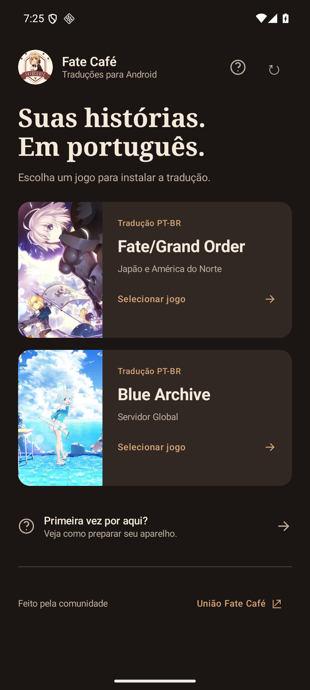
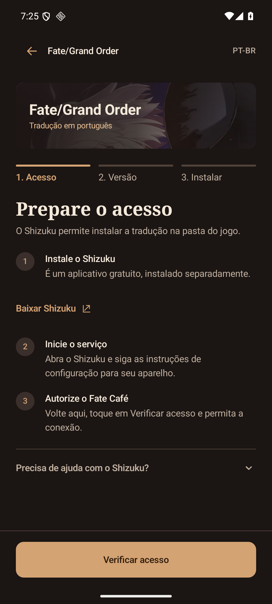
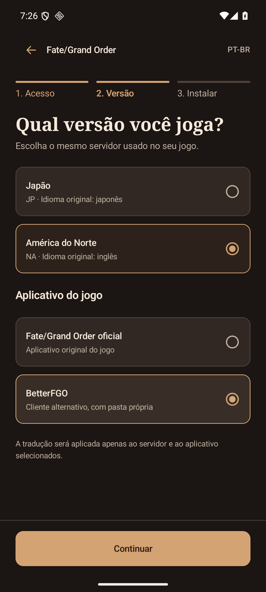
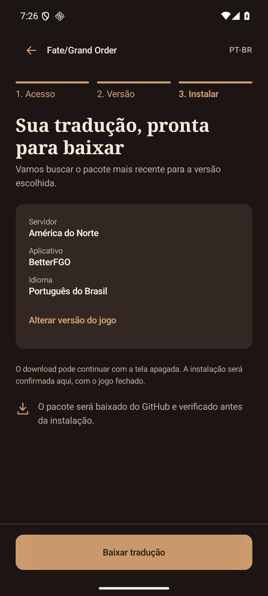
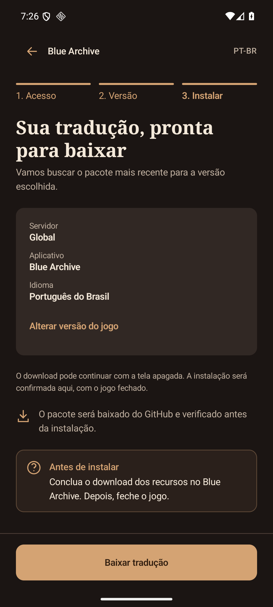
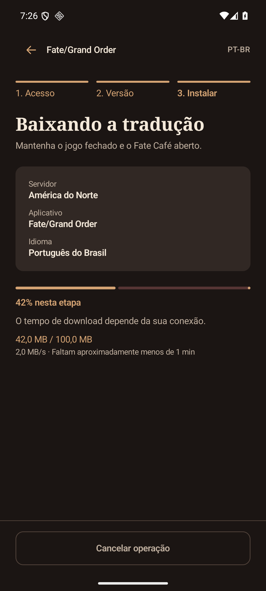
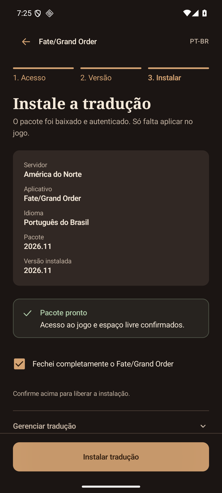
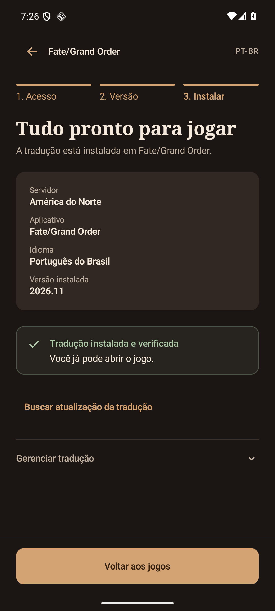
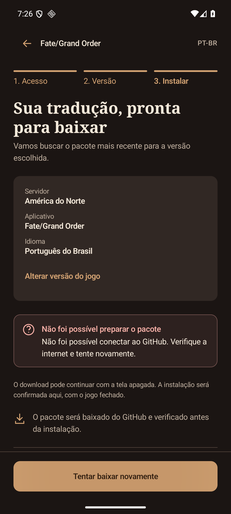
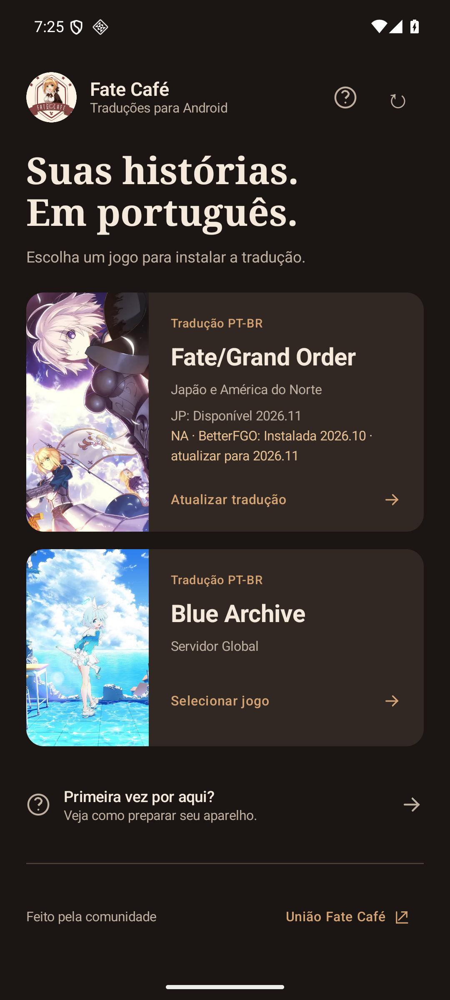

# Nova interface do Fate Café

O instalador agora conduz uma decisão por vez: **Acesso → Versão → Instalar**.
O catálogo usa as imagens dos jogos, e a ação principal fica fixa no rodapé.
Os registros de operação ficam recolhidos em “Detalhes técnicos”.

Na versão 0.8.0, o catálogo também mostra as versões disponíveis e instaladas,
o destino escolhido fica salvo por jogo, e o download informa tamanho,
velocidade e estimativa. A transferência pode continuar fora do aplicativo,
com notificação e retomada. Veja [os detalhes dessas melhorias](downloads-and-catalog.md).

## Capturas

Capturas da interface Compose executada no emulador Android 16 (API 36),
1080 × 2400, densidade 420. Os testes fornecem estados controlados de
autorização, pacote, progresso e recibo; não baixam traduções nem instalam
arquivos de jogos. As telas de conclusão demonstram a interface desse estado,
e não uma instalação real concluída no emulador.

| Catálogo | Acesso ao Shizuku | Servidor e aplicativo |
| --- | --- | --- |
|  |  |  |

| Revisão | Blue Archive | Download |
| --- | --- | --- |
|  |  |  |

| Instalação / atualização | Conclusão | Recuperação de erro |
| --- | --- | --- |
|  |  |  |

| Versões e atualização no catálogo |
| --- |
|  |

## Organização do código

- `MainActivity`: ciclo de vida, permissões Android e ligação com o ViewModel.
- `ui/FateCafeApp`: catálogo, seleção de jogo e ajuda.
- `ui/InstallerScreen`: navegação por etapas, instalação e gerenciamento.
- `ui/CafeComponents`: componentes visuais compartilhados.
- `ui/InstallerMessages`: mensagens e códigos para diagnóstico.
- `ui/theme/BaristaLatteTheme`: cores e tipografia.
- `download/TranslationDownloadService`: transferência em primeiro plano e notificações.
- `download/BackgroundDownloads`: estado da sessão, cancelamento e cópia para verificação.
- `data/remote/ResumeCheckpoint`: identidade do pacote e transporte parcial privado.
- `data/GamePreferences`: escolhas por jogo e identidade da versão instalada.

O ViewModel integra o catálogo e o novo transporte ao verificador existente.
A autenticação, as políticas de arquivos e o motor transacional continuam
exigidos antes da instalação. A UI respeita as capacidades e o recibo
antes de habilitar a instalação, bloqueia a navegação durante operações,
retorna ao acesso se a permissão for perdida e confirma a desinstalação.

Veja [a direção de design](design.md), [as imagens utilizadas](assets.md)
e [o relatório de validação](validation.md).
